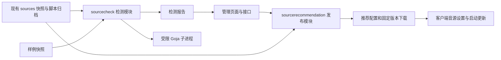

# 音源检测、推荐发布与客户端接入实施方案

- 日期：2026-11-16
- 状态：阶段 A 检测核心、阶段 B 管理界面、阶段 C 推荐发布及客户端接入已实现并完成 Windows 验证。Linux/NAS 目标部署仍待验收。
- 后端：`F:/cyapi-go`；客户端：`F:/CyreneMusic`。
- 文档目的：统一产品交互、架构边界、数据与接口约定、实施顺序和验收条件。

实施顺序：先集成真实脚本检测，再提供管理界面，最后实现推荐发布和客户端接入。各阶段先实现功能，再复用现有测试并实际运行验证；不先建设独立测试平台，不把尚未实现的推荐功能当作第一阶段验证前提。

## 1. 最终决策与范围

采用“后台检测与管理 → 管理员发布 → 固定推荐音源入口 → 客户端按普通音源使用”。

用户在现有音源设置页选择“推荐音源”，即接受管理员后续发布的脚本版本；选择普通源、本地导入源或 Navidrome，则使用自己的选择。无需新增“跟随模式”开关。

核心约束：

1. 推荐入口身份固定，实际脚本按内容哈希保存和下载，原始字节不改写。
2. 检测提供证据，管理员决定发布；检测任务不自动更换推荐。
3. 自动应用只发生在启动播放恢复之前；运行期间只检查、缓存，不自动切换活动运行时。
4. 下载、校验或准备失败保留旧版本；脚本初始化成功不等于歌曲可播放。
5. 每次解析使用确定的脚本版本，不增加失败后跨源轮询、播放重试或音质降级策略。
6. 一个 Go 服务内集成 Goja，通过同一二进制的内部子进程执行检测。运行环境不新增 Node、Redis、消息队列或 FFmpeg。
7. 第一版支持单服务实例、一个全局推荐入口、QQ/网易标准音质检测；文件存储，暂不新增数据库表。
8. 管理页面使用 Go 模板和少量 JavaScript，内嵌到后端。复用用户登录，额外检查管理员授权。

第一版不承诺：所有脚本完全兼容、音频完整解码、歌曲内容身份验证、服务端通过即所有客户端可播放、推荐发布后立即影响正在运行的客户端。

## 2. 已核实的工程事实

| 位置 | 当前行为 | 实施约束 |
| --- | --- | --- |
| 后端 `internal/sources/http.go` | `/lx/sources` 返回 `path/name/directory`；`/lx/script` 按当前快照路径下载，校验哈希并输出 ETag | 新字段向后兼容；增加按指定内容版本下载能力 |
| 后端 `internal/sources/snapshot.go` | 快照带读取租约；`Open` 校验大小，不负责内容哈希校验 | 检测与发布读取都需限量读取并校验哈希；复制完释放租约，再执行网络任务 |
| 后端 `cmd/cyapi/maintenance.go` | 同步和备份在一个维护循环中串行执行 | 检测使用独立调度，不能内联到该循环 |
| 后端 `cmd/cyapi/main.go` | `sources` 命令目前在数据库初始化前分流 | worker 提前分流；管理命令不得意外改变原有 status/rollback 初始化要求 |
| 后端 `internal/backup/backup.go` | 备份数据库、当前音源快照及特定恢复文件 | 新样例、发布记录、归档脚本必须显式加入备份，不能认为自动包含 |
| 后端 `internal/auth/http.go` | 现有 Bearer 登录认证；`CurrentUser` 可取得用户 | 新增管理员用户 ID 白名单授权，不把普通登录等同管理员 |
| 客户端 `lib/models/lx_source_candidate.dart` | 列表路径必须是合法 `.js` 路径；目录须与路径匹配 | 虚拟推荐路径遵守现有约束，名称由列表元数据提供 |
| 客户端 `lib/services/audio_source_service.dart` | 选源操作串行化；保存 `catalogPath` 和脚本；启动通常读取本地脚本 | 保留推荐入口身份，新增实际版本记录和启动检查 |
| 客户端 `lib/services/lx_music_runtime_service.dart` | 已有 `prepareScript` 和候选 `commit`；提交后销毁旧运行时 | 复用能力，但不能在播放恢复后自动提交候选 |
| 客户端 `lib/main.dart` | 音源初始化在服务初始化批次，播放恢复在后续启动流程 | 增加明确启动门禁，而不是在初始化后另起无约束更新任务 |

客户端 `docs/ADMIN_PANEL.md`、`docs/ADMIN_QUICK_START.md` 描述旧后端/客户端管理能力，不是当前 Go 服务管理页面已存在的证据；本方案不继承其中的默认密码或旧管理接口。

原型验证证据见 [Goja 验证报告](../artifacts/goja-source-probe-validation-2026-11-13.md)：27 份脚本初始化成功，54 项中 22 项返回地址；与 QuickJS 分类对照 53/54 一致。这只支持执行器选型，不证明完整运行时等价或音频可用。Linux 构建产物尚未完成目标服务器运行验证。

## 3. 产品体验

### 3.1 客户端音源设置

复用现有页面，推荐入口置顶，其余候选、已配置音源、自定义导入和 Navidrome 保持现有入口。

```text
音源设置

┌ 推荐音源 ───────────────────────────────────┐
│ 当前推荐：音源 A                            │
│ 网易：3/3 资源检查通过 · QQ：2/3 通过        │
│ 检测于 20 分钟前                            │
│ 启动时检查推荐更新                 [使用]   │
└─────────────────────────────────────────────┘

其他音源                         [搜索] [筛选]
音源 B                               [使用]
音源 C                               [使用]

已配置音源 / 自定义导入 / Navidrome
```

图中文字与通过率仅为示例，不代表实测可用性。

用户动作及反馈：

| 动作/状态 | UI 与行为 |
| --- | --- |
| 未选择推荐入口 | 主按钮“使用”，显示后台当前推荐及对应报告摘要 |
| 点击使用 | “正在加载…”；成功才修改选择；失败显示原因，原选择保留 |
| 已选择推荐入口 | 标记“当前使用”，显示“本机版本：A”，按钮“检查更新” |
| 后台推荐 B，本机仍是 A | 同时显示“本机版本：A”“最新推荐：B”，不得提前把 B 标记为当前使用 |
| 运行期间自动检查发现 B | 下载后提示“新版本已缓存，下次启动应用”；可由用户主动更新 |
| 更新失败 | 卡片内提示“更新失败，仍使用 A”，提供重试；详细诊断写日志 |
| 手动使用其他源 | 成功后普通源变为当前使用；不再自动更新推荐源；无额外确认弹窗 |
| 未发布推荐 | 有正常候选列表时仍可选其他源；新客户端显示“暂未配置推荐音源”，不提供无效下载按钮 |
| 推荐报告过期/缺失 | 显示“检测结果已过期/未检测”；不伪造可用状态，不阻断管理员已发布脚本的下载 |

旧用户升级保持原选择。新用户无音源时主操作为“使用推荐音源”，并保留浏览其他源/导入操作；不后台静默切换已有用户。

推荐不是普通脚本名称：即使实际脚本内部名称是 A，客户端仍将该选择显示为“推荐音源 · A”。直接选择普通 A 不等于选择推荐入口。

### 3.2 管理页面

同源 `/admin/source-management`，两个标签：

1. **音源与推荐**：当前推荐卡片、推荐历史、音源检测表、批次进度。
2. **测试歌曲**：平台、歌曲、歌手、时长依据、元数据状态、启停与删除。

音源表按 QQ/网易分别展示；提供单源检测、全部检测、详情、设为推荐。点击平台结果展开到歌曲，展示失败阶段、可读原因、耗时、格式及预期/实际时长；脱敏请求诊断放在详情下层。

发布确认页显示：当前推荐 → 目标源、目标 SHA256 的短标识、对应检测时间、样例覆盖和异常。未经检测、过期或未全部通过时显示提示，允许管理员填写发布说明后主动发布；系统不自动推断“检测通过就应该发布”。

目标内容与当前一致：返回“当前已推荐该版本”，不创建新发布。回退选择历史版本并创建新的发布记录，不改写历史记录。

检测任务返回任务 ID 后异步运行；页面每 2 秒轮询，后台标签页可降低频率，任务结束停止轮询。关闭页面不取消任务。相同任务重复提交返回已有任务；不同任务在已有批次运行时返回忙碌状态，第一版不积压队列。

## 4. 模块与依赖方向



建议目录（按职责建立，不要求一个类型一个文件）：

```text
cmd/cyapi/
  main.go                         # 接线、生命周期、内部 worker 提前分流
  source_check.go                  # 运维检测命令
  source_probe_worker.go           # worker 协议入口
internal/
  sources/                        # 快照与校验读取；注入推荐目录/下载接口
  sourcecheck/
    types.go, samples.json        # 输入/报告契约、默认样例
    service.go, management.go     # 批次执行、文件报告、样例管理与取消
    metadata.go                   # 歌曲详情适配
    executor.go, worker.go        # 子进程协议、资源边界
    runtime.go, http.go, utils.go # Goja 与 LX 兼容
    network.go, resource.go       # 公网地址限制与音频检查
    platform_linux.go, platform_windows.go
    backup.go, sandbox/
  sourcerecommendation/
    store.go                      # 发布、回退、CAS、归档、备份和清理
    http.go                       # 推荐描述、摘要、固定入口及按哈希下载
    platform_linux.go, platform_windows.go
  admin/
    http.go                       # 管理员授权、管理路由
    web/                          # HTML、CSS、JS，go:embed
  backup/, config/                # 备份清单、配置接线
```

不让脚本执行器依赖数据库、推荐发布或页面；不让页面层直接改文件。`sources` 不导入检测模块，列表摘要通过组合层/只读接口注入，避免循环依赖。

worker 在配置、数据库和提供商初始化之前分流，类似现有内部命令。标准输入读取任务，标准输出只允许一个有大小限制的 JSON 结果，标准错误输出受限诊断。worker 不读取后端 secrets/config，不继承含凭据的环境变量。

锁定 Goja 版本到现有后端 `go.mod`。原型独立模块的 Go 版本、SDK、可执行文件和测试输出不整体复制进生产目录；先核实后端 toolchain 可构建。

## 5. 数据模型与持久化

### 5.1 身份与版本

| 字段 | 定义 |
| --- | --- |
| `sourceKey` | 推荐入口固定为 `recommended`；普通源使用来源快照中的路径身份 |
| `backendOrigin` | 客户端当前后端的规范化基址，包含部署前缀；推荐配置按后端隔离 |
| `scriptSha256` | 下载前原始文件字节的 SHA256；不能对换行规范化后的字符串计算 |
| `releaseId` | 每次有效发布新生成的不可复用 ID；按不相等判断变化，不按数字大小判断 |
| `sampleSetVersion` | 一批启用样例及元数据快照的内容哈希 |
| `probeVersion` | 检测器和 JS 兼容层版本标识 |

采用不透明 `releaseId` 替代前期讨论的单调数字版本：回退和恢复旧备份不会因“版本号变小”被客户端忽略。目标哈希相同但发布记录变化时，只更新元数据，不重新初始化相同脚本。

### 5.2 推荐发布记录

至少包含 `format/releaseId/previousReleaseId/scriptSha256/originalPath/originalName/publishedAt/publishedBy/note/reportRunId`。发布中的报告引用可为空，但若存在必须匹配目标脚本哈希；不能关联同名不同版本的报告。

文件布局：

```text
<runtimeDirectory>/source-checks/
  samples.json
  latest.json                     # 可重建的摘要索引，不是唯一历史来源
  runs/<run-id>.json

<runtimeDirectory>/source-recommendations/
  current.json                    # 指向不可变发布记录
  releases/<release-id>.json

<sources.directory>/published/
  <sha256>.js                     # 被发布脚本的原始字节，小量内容归档
```

`published` 是 `sources` 新增的内容归档区，不把虚拟推荐文件写进远端同步 manifest，也不为保留一个脚本永久保留整批同步文件。归档重复内容去重。

业务写入持有统一锁，涉及独立进程时采用跨进程锁；不能只依赖原子 rename。先写临时文件、关闭并同步、使用平台支持的替换操作发布，必要时同步父目录；Windows 需要验证替换已有文件的实际语义。

发布顺序：校验并归档脚本 → 写不可变发布记录 → 原子更新 current。指针更新失败即发布失败，原推荐不变；孤立归档/记录可后续清理。客户端永远读取完整的一份发布记录。

发布采用 `expectedReleaseId` 比较并交换：两个管理员并发操作，后提交者看到 409 并刷新，不静默覆盖。恢复上一版也是新发布，带新的 ID 和操作者。

默认保留最近 20 条发布历史、最近 30 天且最多 100 份批次报告。当前/上一版及保留历史引用的脚本不得删除。下载中的归档文件有读租约；清理有宽限期。索引损坏可从报告重建，推荐指针损坏不能随意猜一个新推荐。

批次状态为 `running/completed/canceled/interrupted/failed`。每完成一个样例更新有界报告快照；重启发现 running 标为 interrupted，允许重跑，不恢复半个 JS 请求。部分批次只更新已完成样例的索引，其他记录保留原检测时间，不把整批旧结果一概覆盖为最新。

### 5.3 样例

每个样例包含 `id/platform/trackId/enabled/title/artists/musicInfo/expectedDurationMs/durationEvidence/metadataStatus/updatedAt`。

- 默认 QQ、网易各 3 首，使用真实客户端格式的 `musicInfo`，不手写臆造平台专用字段。
- 添加时获取并校验元数据；失败则不创建“可执行”样例，页面明确原因。
- 不保存 Cookie、Token、临时播放 URL；授权敏感字段不从客户端会话复制。
- 完整时长有依据才保存；未知值为 null，禁止填 0 伪装已知。
- 支持主动刷新元数据。发生变更则产生新的样例集合版本。
- 批次创建时固定脚本、样例、音质和检测器版本，运行期间修改不会改变本批输入。

## 6. HTTP 契约

以下契约已实现；操作说明见后端 `docs/13-source-checks.md` 和 `docs/14-source-recommendations.md`。沿用当前 JSON `status` 外层风格，增加字段不删除旧字段。

### 6.1 公共客户端接口

| 接口 | 行为 |
| --- | --- |
| `GET /lx/sources` | 保留旧三字段；普通项可增加 `sha256/health`；存在发布时注入固定推荐项 |
| `GET /lx/recommendation` | 返回完整当前发布描述及检测摘要；未发布为 404 `recommendation_unpublished` |
| `GET /lx/script?path=推荐/recommended.js` | 兼容旧客户端，读取一次发布快照后返回对应原始脚本 |
| `GET /lx/script?path=推荐/recommended.js&sha256=<hash>` | 新客户端指定不可变内容；只允许发布归档中的有效哈希，不接受文件系统路径 |

推荐列表项示例：

```json
{
  "path": "推荐/recommended.js",
  "name": "推荐音源",
  "directory": "推荐",
  "kind": "recommendation",
  "releaseId": "opaque-release-id",
  "sha256": "<64位小写十六进制>",
  "resolvedName": "音源 A",
  "publishedAt": "2026-11-13T08:00:00Z"
}
```

保留该虚拟路径命名空间，目录同步遇到冲突不得产生两个相同路径项。普通列表可正常返回时，不因检测报告缺失/管理模块故障导致 `/lx/sources` 整体失败；已发布推荐归档可正常读取时，也不依赖当前上游同步快照可用。

推荐配置使用条件请求与 `Cache-Control: no-cache`。如果响应包含可更新的检测摘要，ETag 必须覆盖整份响应（发布记录和报告版本），不能只使用 releaseId，否则同一推荐的新报告会被错误缓存。结果是否过期由客户端按 checkedAt/expiresAt 计算；报告变化不触发脚本重新加载。按哈希下载输出内容哈希 ETag，可长期缓存；兼容的可变路径必须重新验证，不能长期缓存。新客户端从一份描述取得 releaseId 和 sha256，下载过程中不重新解释“当前推荐”。

哈希已清理返回 410，未知哈希返回 404；客户端刷新描述至多一次，不能无限重试。公共摘要不含完整签名 URL、请求头或原始响应正文。

### 6.2 管理接口

所有 `/admin/source-*` 数据接口须先认证再检查管理员授权。公开静态登录页面不含敏感数据。

| 接口 | 作用 |
| --- | --- |
| `GET /admin/source-management` | 管理页静态壳和登录入口 |
| `GET /admin/source-checks/samples` | 样例及版本 |
| `POST /admin/source-checks/samples` | 按平台和 ID 添加，完成元数据校验后返回 |
| `PATCH /admin/source-checks/samples/{id}` | 启停；显式刷新元数据使用独立 action 字段 |
| `DELETE /admin/source-checks/samples/{id}` | 删除，影响后续批次 |
| `POST /admin/source-checks/runs` | 创建批次；202 + runId；后台生命周期不绑定请求 context |
| `GET /admin/source-checks/runs/{id}` | 进度、报告及脱敏诊断 |
| `POST /admin/source-checks/runs/{id}/cancel` | 幂等取消 |
| `GET /admin/source-checks/overview` | 列表摘要、当前批次、当前推荐 |
| `GET /admin/source-recommendations` | 当前推荐和有限发布历史 |
| `POST /admin/source-recommendations` | 发布或回退；携带目标哈希、expectedReleaseId、说明和报告引用 |

请求需限定体积、平台枚举、路径、数量和字段长度。发布目标必须来自已校验的同步脚本或现有发布归档，不允许通过管理 API 传任意服务器路径或任意 URL 下载并发布。普通脚本的发布选择携带 generation/path/sha256，后端按这一确定版本读取；该版本已经不可读则返回 409 要求刷新，不自动发布同名最新脚本。回退按归档哈希读取。

认证复用 `/auth/login` Bearer Token，管理授权由配置中的管理员用户 ID 白名单提供，每次请求检查。第一版 Token 只保存在页面内存，刷新页面可重新登录；不引入旧后台密码机制。后台页面同源提供，不开放管理接口的跨域权限；若后续改 Cookie 登录，必须同步引入 CSRF 校验。

发布审计保存操作者 ID、前后版本、时间和说明。身份正常但非管理员返回 403，未认证返回 401。登录不成功不得回显账户或凭据细节。

## 7. 检测执行设计

### 7.1 批次与调度

每个脚本/平台/音质/歌曲一个新 worker，优先可靠隔离，不做运行时池。第一版并发 1。27 份脚本 × 2 平台 × 3 首最多 162 个任务，页面显示实际计划数、已完成数和阶段；不承诺几秒结束。

若脚本明确不声明支持平台，可以跳过该平台其余样例并标记 unsupported。单首无权限、返回空地址或字符串含“失败”不能推断整个平台不可用。没有可靠结构化全局错误依据时继续按样例测试；任何跳过都记录原因，不能算作已测失败。

定时功能默认关闭。手动闭环验证后可开启：每分钟扫描变更/到期项，默认结果有效期 24 小时，每个平台首批完成后才能产生覆盖结论。网络暂时失败使用受限退避，最早 30 分钟后重试，避免验证码或限流时持续请求；管理员可主动重测。

脚本新增、内容变化、样例变化或检测器变更都使对应旧报告不再代表当前验证；UI 显示待检测或旧记录，不自动撤回推荐。扫描当前 manifest 而非仅监听维护同步成功，覆盖外部 CLI 同步和回滚。

### 7.2 证据模型

每个样例记录：

- `initialization`：ok/failed/unsupported。
- `resolution`：ok/failed/timeout/canceled。
- `resource`：recognized_audio/invalid/unreachable/unverified。
- `duration`：observedMs、method、confidence、expectedMs、assessment。
- `failureOrigin`：source/network/probe/sample/resource；无法归因则 unknown。
- 阶段耗时、受限的 HTTP 状态/业务错误、runId、脚本和样例版本。

`recognized_audio` 表示读到了可识别的音频结构，不表示完整解码或完整播放成功。音频格式未支持、读取预算耗尽导致无法判断，均为 unverified；如果时长未知，不能标记完整音频通过。

界面分别计数通过、失败、未验证、跳过；例如“2 首资源检查通过，1 首未完成验证”。HTTP 200、文件扩展名、Content-Type 只能作为证据的一部分。

默认时长差异规则仅作可配置的疑似标记：双方时长可靠且实际小于预期 80%，同时相差超过 15 秒时，标记 suspected_short_resource。未知时长不参与；接近完整时长也不能证明是正确歌曲。管理员报告展示计算依据。

### 7.3 资源验证与请求上下文

解析完成后在同一个 worker 中立即验证资源，避免把临时签名 URL 写入报告或丢失必要请求信息。只携带客户端协议明确支持的解析结果请求头；不自动把某个第三方接口的 Cookie/Authorization 转发到音频域名。

使用有上限的 GET，允许 Range，但处理服务器忽略 Range 的情况；达到预算立刻停止读取。区分 HTML/JSON 错误页、可识别音频头、重定向错误和未知格式。第一版覆盖 MP3/FLAC 的可可靠读取信息；MP4/AAC/HLS 等未实现项目标记未验证，禁止假定为失败或成功。

MP3 的 VBR 信息缺失时不得只凭局部码率和 Content-Length 声称获得可靠完整时长。资源读取、跳转、解析头部均计入任务预算。不额外下载完整歌曲作为永久缓存。

### 7.4 执行边界

以下是初始工程默认值，须用目标服务器实测验证，不是已经证明合理的性能结果：

| 项目 | 初始值/规则 |
| --- | --- |
| 脚本文件 | 8 MiB；超限记 probe_limit，不记音源不可用 |
| 初始化/解析/资源阶段 | 分别最多 12s/12s/8s，整个 worker 最多 40s |
| 单个 JS 同步执行轮次 | 初始化 5s、解析 1.5s，中断错误单独标记 |
| HTTP 响应 | 解压后单个不超过 8 MiB，任务累计不超过 32 MiB |
| 音频读取 | 累计最多 8 MiB，包含在任务下载总量内 |
| 请求数/同时请求数 | 任务最多 64 个，最多 4 个同时执行 |
| 定时器/待处理回调 | 分别限制为 256，超限终止并归因 probe_limit |
| worker stdout/stderr | 各最多 256 KiB；超限终止，不使用无限 Buffer |
| 重定向 | 每次最多 5 跳，每一跳重新验证目的地址 |
| 内存 | 初始目标上限 512 MiB/worker，部署验证后调整 |

子进程隔离不是完整安全沙箱。脚本网络仅允许公网 HTTP(S)，连接与重定向都校验解析地址，阻止环回、私网、链路本地及云元数据访问；连接使用已验证地址，避免 DNS 重绑定绕过。默认不继承系统代理；现有 `Sources.ProxyURL` 仅用于同步，不能悄悄复用到探测。需要代理时另设明确的探测配置并记录检测环境。

Linux 目标环境使用可用的 cgroup/容器硬限制，Windows 使用 Job Object 等实际进程限制。`GOMEMLIMIT` 只能作为软约束；不以它替代硬限制，也不盲目对 Go 使用过小虚拟地址空间限制。目标部署无法落实进程资源隔离时，自动检测保持关闭，先完成部署适配。

worker 使用最小环境、受控工作目录；外层负责超时后终止并等待回收。取消覆盖 HTTP、定时器和子进程，服务退出不得无限等待。JSON 协议校验格式版本、jobId、脚本哈希、平台和样例 ID，禁止把不匹配输出计入报告。

## 8. 客户端状态与启动时序

### 8.1 本地记录

在现有音源配置上兼容扩展入口信息及实际版本：`catalogKind/backendOrigin/releaseId/scriptSha256/resolvedName`。现有 `catalogPath` 仍保存固定推荐路径。旧配置缺少这些字段时按普通源处理，不凭脚本名称猜测推荐身份。

待更新内容单独保存，包含完整描述、原始字节哈希和内容。活动记录、待更新记录、最后一次更新失败原因相互独立；不把“已下载”写成“已应用”。校验哈希发生在字节解码之前。

后端切换使旧后端待更新任务失效，迟到结果不得发布。保留已下载活动脚本供本地使用，并提示“该推荐来自原服务器，请选择当前服务器的推荐音源”；用户明确选择后才绑定新后端，不能把旧推荐身份自动转交给新服务器。

### 8.2 自动更新窗口

第一版自动提交窗口仅限启动播放恢复之前。实现为推荐更新协调器与现有音源服务之间的一次明确启动门禁，不增加播放解析器内部选源逻辑。

步骤：

1. 读取本地选择；普通源直接走现有初始化。
2. 推荐入口读取并校验本地活动版本，保存可恢复的回退配置，暂不重复初始化两个运行时。
3. 开启一个有身份和取消标识的版本选择窗口；额外的联网等待预算默认 3 秒，查询最新描述，取得已缓存或及时下载完成的匹配脚本。
4. 窗口结束时固定本次初始化目标：有已确认的完整新脚本则选择新脚本，否则选择本地活动版本。迟到下载仅保存缓存，不改变本次目标；首次没有本地版本走显式配置加载流程。
5. 对固定目标使用现有正常脚本初始化预算独立准备候选，不受上述 3 秒联网预算限制。否则原型中超过 3 秒才初始化完成的合法脚本将永远无法自动应用。准备新版本失败则使用本地旧版本完成正常初始化，不重复下载或无限重试。
6. 有资格的提交复用现有串行选源和持久化流程；初始化及提交/回滚结束后才开放播放恢复。用户切源或后端改变使自动任务资格失效，候选必须释放；3 秒不是启动总耗时承诺。
7. 进入播放恢复后，本次启动窗口永久关闭；运行期间刷新列表不会重新打开。阶段 C 必须记录新版本失败后回退造成的实际启动额外耗时。

注意：联网等待结束只固定本次脚本选择，初始化仍由明确启动步骤负责。禁止对整个激活函数简单 `Future.timeout` 后就放行播放恢复，因为原 Future 可能继续保存配置并 commit。需要在进入持久化之前、异步保存完成之后、同步 commit 之前核对提交资格；提交中止时完成持久化恢复，再解除门禁。现有 SharedPreferences 多键写入不是跨键事务，要验证故障回滚和进程中断恢复，不能声称原子持久化已经具备。

用户在联网选择阶段提前点播放，则结束额外联网等待并选择本地版本；如果已进入脚本初始化或提交，则播放请求等待该初始化/提交或回退结束，不能与提交并发。门禁范围只覆盖源确定与正常初始化，不延伸到整首歌播放。

已缓存但无法确认仍是最新推荐的脚本，后台不可达时不自动应用；继续活动版本，避免发布已撤回后离线误应用。联网成功且 SHA 相同可复用缓存，重新做运行时准备。

### 8.3 手动更新

“使用”或“检查更新”属于用户主动操作，复用现有手动选源流程；有正在解析的任务时采用已有取消/串行语义。第一版不承诺手动切换对旧解析透明，只要求结果不会串入新请求、不产生双重播放、失败时保留可恢复配置。

不修改 `TrackResolver` 的跨源策略、播放器重试策略或默认解析超时。相关日志补充入口身份、releaseId、scriptSha256，保留现有 tx/request 关联。

## 9. 配置、备份与运维

当前实际配置（默认关闭）：

```yaml
admin:
  enabled: false
  user_ids: []
source_recommendation:
  enabled: false
```

第一版仅手动检测，没有 `source_checks` 配置或自动调度。解析超时、24 小时报告有效期、最近 20 条发布历史等边界为代码常量，不接受尚未实现的配置项。严格配置解析会拒绝未知字段。

管理授权与公共推荐入口独立控制。关闭公共入口不删除发布记录，也不删除客户端本地脚本；可在未公开时先完成发布准备。检测不会自动替换推荐。

配置解析遵循现有严格校验，字段加入配置模板、帮助和测试。读取损坏的新模块数据只降级相应模块，保留健康 API 和普通源能力；日志暴露原因。启动不自动修复或清空损坏的推荐记录。

CLI `sources check` 与在线管理任务取得同一跨进程锁，不允许同时写同一批次。管理 UI 为第一版主要入口；worker 内部命令不作为普通运维接口。

备份显式包含样例、推荐 current、保留发布记录、它们引用的 published 脚本以及必要的检测报告。备份先取得一致的引用集合并持有读租约，复制完成前清理不得删除引用文件；不因扫描中途发布而混合两版 current 与脚本。

备份清单增加新模块文件及校验和，验证现有恢复工具的兼容性；格式确需升级时提升备份格式版本。恢复后检查所有推荐引用，缺文件则推荐模块报告不可用，不随意指向当前同名脚本。

本功能不新增数据库迁移。回滚新后端到旧版本时新文件可保留，但推荐入口将不可访问；已缓存脚本可继续本地使用。新客户端面对旧后端 404 应降级为无推荐能力，不能把普通源列表一起判定失败。上线顺序为后端先支持协议，再发布客户端。

## 10. 安全与可观测性

安全控制围绕新增执行和发布能力：管理员授权、原始脚本校验、进程/网络资源边界、请求目的地址限制，以及公共输出脱敏。未实现这些边界不开放自动执行。

每个批次有 runId，每个任务有 jobId；每次发布有 releaseId。日志串联：

```text
runId + jobId + scriptSha256 + platform + sampleId + stage + elapsedMs
releaseId + previousReleaseId + scriptSha256 + actorId
客户端 backendOrigin + sourceKey + releaseId + scriptSha256 + tx/request
```

不能记录 API Key、Cookie、Authorization、完整带签名 URL 或无限响应正文。保存域名、HTTP 状态、脱敏的有限业务错误摘要；管理页使用文本渲染，不将脚本错误当 HTML。

探测失败、发布失败和客户端更新失败分开计数。管理页“已发布”只表示服务端发布完成，不显示未经客户端上报证实的“所有客户端已更新”。第一版不新增客户端遥测系统。

## 11. 分阶段实施与验收

### 阶段 A：实现后端音源检测

先将已有 Goja 原型集成到后端：从现有脚本目录读取真实脚本，以 QQ/网易歌曲为输入，执行解析和资源检查，保存可读结果。交付包含默认样例、worker、手动批次入口和报告，不依赖推荐入口或客户端改动。

随功能实现验证：

- [x] 对当前目录的真实脚本跑 QQ/网易解析，逐项输出脚本版本、歌曲、耗时及结果。
- [x] 返回地址后进行资源检查；错误页面、不可识别格式、未知时长不能误报完整可用。
- [x] 保存具体失败阶段和原因，区分脚本失败、样例错误和检测器限额。
- [x] 复用原型契约测试，补超时、取消、输出限制和网络访问边界测试；实现子进程资源约束。
- [ ] 在目标服务器实际执行并记录资源占用；不能用跨平台编译代替实测。

阶段 A 的结果是一项可以真正执行、查看报告的后端检测功能，不是测试工具的计划或模拟推荐源。

### 阶段 B：实现检测管理界面

接入阶段 A 的实际能力，交付管理员授权、样例增删、手动检测、进度和报告详情，以及相应文件备份。此阶段即可日常管理和判断脚本情况。

随功能实现验证：

- [x] 管理员能添加真实 QQ/网易样例，启动检测，查看逐首结果与失败原因。
- [x] 普通用户无法操作；关闭页面不取消任务，重复提交不创建重复批次。
- [x] 样例修改只影响后续批次，历史结果保留输入依据。
- [x] 检测数据备份及恢复读取、运行中备份测试通过；独立任务与普通 API 并行。目标机器性能仍待实测。

阶段 B 验证：Windows 全量测试、真实浏览器登录/列表/样例启停/启动取消/报告/退出通过；截图见 artifacts/sourcecheck-stage-b-2026-11-13。运行中备份及恢复读取测试通过。解除测试进程沙箱网络限制后，真实 QQ/网易详情新增均返回 201，时长分别为 212000ms、275912ms，随后删除均成功。

低频自动检测在手动功能及目标部署资源限制验证后开启，不作为先做出可用管理界面的前置条件。

### 阶段 C：实现推荐发布及客户端接入

在已有检测和管理功能上增加“设为推荐”、固定入口、版本下载、回退，以及客户端展示和启动更新。先实现这些实际功能，再验收，不额外建设完整故障模拟平台。

核心用户验收：

- [x] 管理员推荐 A，客户端选择推荐入口后实际加载并使用 A。
- [x] 改为 B 后客户端下次启动取得 B，运行期间不会自动切换当前播放所用运行时。
- [x] 更新断网或脚本准备失败时保留原版本，显示真实失败原因；回退能生效。
- [x] 用户手动选择其他源后，推荐变化不覆盖其选择。

围绕新增代码复用既有测试，覆盖按哈希下载的一致性、并发发布、更新迟到不得提交、持久化失败恢复及备份引用完整性。明确检查新旧客户端/后端兼容。无需为这些用例新增独立测试服务产品。

自动更新必须通过启动时序验证后开启；不能为了通过验收省略失败保留和迟到结果隔离。不修改无关播放策略，不为纯样式或简单 getter 增加镜像测试。

## 12. 最终检查结论与实施门槛

本方案已关闭前期讨论中的主要歧义：

1. “推荐音源”是固定入口，不是动态拼装的聚合 JS。
2. 更新比对内容哈希，发布识别使用不透明 releaseId；支持回退和恢复。
3. 旧接口兼容可变入口，新客户端下载明确版本，避免列表/下载竞态。
4. 自动应用限定启动窗口，运行期间不后台提交；复用候选准备，并已实现启动时序门禁。
5. 新管理页面及管理员授权属于工作范围，旧后台文档不视为可复用实现。
6. 文件存储仍需跨进程互斥、备份扩展、恢复校验和清理引用保护。
7. 检测状态表达证据和未知，不将 URL、HTTP 200 或时长近似当作播放成功证明。

尚待目标服务器实测：Linux/NAS 的进程内存限制、真实出口检测及资源占用。Go 资源检查限 MP3/FLAC 信息读取，不能证明完整解码；不启用自动定时检测。客户端持久化故障、启动门禁与后端备份引用已有测试，不能据此声称任意脚本或公网歌曲均可播放。

交付标准：管理员能解释每个检测结果、发布一个确定脚本版本；客户端能清楚显示实际使用版本，更新失败可继续使用旧版本，且不会由推荐更新引入播放恢复竞态。

## 13. 实施状态与验证（2026-11-16）

阶段 A、B 已同步到后端；阶段 C 实现包含推荐发布/回退、按哈希下载、管理页面和客户端启动更新。详细使用方式见后端 `docs/14-source-recommendations.md`。

客户端通过原始字节 SHA-256 后再解码，另存解码内容哈希校验本地持久化脚本。新版本准备、两项配置保存、提交运行时复用原选源事务；推荐更新额外写回退日志，进程中断后冷启动可恢复旧配置。3 秒仅限制额外联网选择窗口，候选准备沿用原脚本初始化预算；超时或提前播放后迟到结果仅缓存，运行中不自动提交。

Windows 验证：客户端 55 项回归通过；真实 Go HTTP + Windows QuickJS 验证 A → 缓存 B（当前仍 A）→ 启动 B → 后台回退并启动 A → 故意报错脚本失败保留 A。后台全量 Go 测试、并发 CAS、最近 20 条历史保留、归档宽限期、摘要 ETag 失效和备份恢复测试通过。管理页真实浏览器完成发布/回退与手机布局检查。记录见 [阶段 C 验证](../artifacts/source-recommendation-stage-c-2026-11-16/README.md)。

阶段 A 真实源检测记录见 [检测结果](../artifacts/sourcecheck-stage-a-2026-11-13/README.md)：54 项仅 9 项资源检查通过，说明“脚本返回地址”不能作为可播放结论。检测与发布分别操作，系统不自动声称某份脚本已全平台可用。

### Review 修复：回退记录收尾与跨服务器展示

推荐事务完成但回退记录删除失败时，客户端保留“待清理”状态。后续音源操作在现有串行队列内先重试删除；仅在底层存储确认成功后继续，持续失败则在配置及运行时变更前报错。SharedPreferences 删除失败也可能先移除内存缓存，因此重试不以 containsKey 为依据。冷启动对未完成事务仍按原规则恢复。

音源列表判断已保存推荐是否由当前目录代表时，同时匹配推荐类型、目录路径和 backendOrigin。其他服务器的推荐保留在已配置列表，并显示服务器地址；可用本地脚本切换，也可删除。未带推荐身份的旧配置继续保留可见。

本次修复后 60 项相关测试通过，覆盖清理失败后的排队切源/删除/导入及冷启动、持续删除失败返回 false 或抛异常时阻止写入、存储恢复后重试、跨服务器推荐离线切换/删除，以及目录身份兼容。改动文件 Dart 静态检查通过。

### 最终 Review 修复：启动恢复、导入转换与发布确认

冷启动恢复将“配置恢复完整”和“回退记录清理完成”分开处理。恢复完整后即使清理失败，仍加载旧配置供本次使用，并在后续保存前重试清理；任一配置键恢复失败则阻止后续音源保存，重启后依据保留记录继续恢复。运行期事务也保持该约束，回退记录写入失败会尝试收尾，部分回退失败时不接受后续覆盖。

编辑推荐源并手动导入新脚本时，通过 asImportedSource 清除目录绑定、推荐类型、服务器、发布版本、原始哈希、解码内容哈希及推荐显示名；保留本地 ID，按普通导入源使用。活动和非活动源均可再次加载，后续启动不再自动获取推荐覆盖它。

后台打开发布/回退确认框时固定 expectedReleaseId。页面刷新只更新后台展示，不能改变该次确认依据；409 冲突保留确认框并要求关闭后重新选择，重复提交旧确认仍会冲突。

本轮 68 项客户端相关回归、3 项后台 JavaScript 回归和 Go admin/sourcerecommendation 测试通过，改动文件 Dart 静态检查通过。后台页面回归可在后端目录运行 node --test internal/admin/web_test.cjs；Node 仅用于开发测试，服务运行没有新增依赖。
